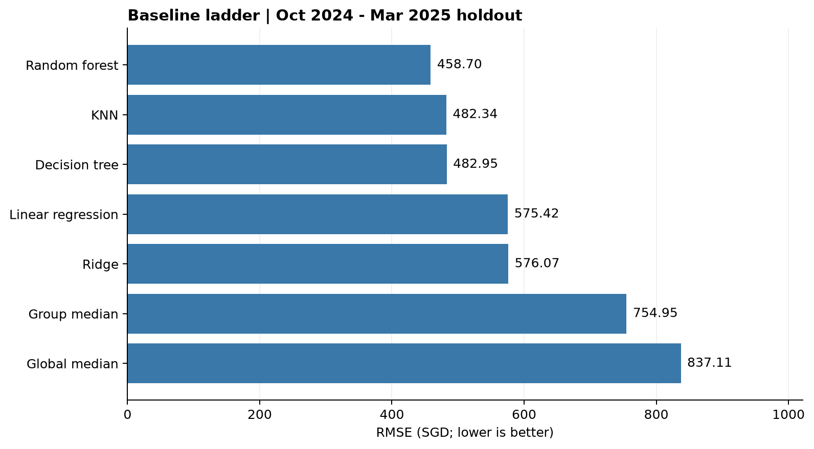

# Baseline evaluation results

The seven models cover the first six items of the Phase 1 baseline ladder. They use raw monthly rent, seed 5228 and a chronological holdout: January 2021 to September 2024 for fitting (132,538 rows), October 2024 to March 2025 for validation (17,037 rows). The cleaned labelled dataset contains 149,575 rows.

## Results

RMSE and MAE are in SGD per month; MAPE is a percentage. Bias is mean prediction minus observed rent. Fit time measures the holdout model fit, excluding learning-curve fits, full-data refits and CV; timings depend on hardware.

| Model | RMSE | MAE | MAPE (%) | R-squared | Bias | Fit time (s) |
| --- | ---: | ---: | ---: | ---: | ---: | ---: |
| Random forest | 458.70 | 337.54 | 12.63 | 0.489 | -50.37 | 95.15 |
| KNN | 482.34 | 354.22 | 13.32 | 0.435 | -20.26 | 0.34 |
| Decision tree | 482.95 | 357.84 | 13.32 | 0.433 | -36.82 | 22.42 |
| Linear regression | 575.42 | 419.21 | 16.90 | 0.195 | 330.22 | 5.13 |
| Ridge | 576.07 | 419.85 | 16.93 | 0.194 | 330.54 | 3.02 |
| Group median | 754.95 | 658.04 | 20.98 | -0.385 | -563.18 | 0.07 |
| Global median | 837.11 | 684.40 | 21.49 | -0.703 | -537.76 | 0.01 |

Full precision and prediction timings: [results_table.csv](../results/member_b/baseline_ladder/results_table.csv).

Random forest achieves the lowest RMSE, improving on KNN by 23.64 SGD, the single tree by 24.25 SGD and Ridge by 117.37 SGD. KNN and the single tree are close, while linear regression and Ridge overpredict by about 330 SGD on average. The group lookup improves on the global median, but every validation quarter is unseen, so all 17,037 validation rows fall back to historical town-and-flat-type medians. Its average underprediction is 563.18 SGD. These results favor the forest among the tested baselines, but linear and KNN models use restricted inputs, so their gaps do not isolate algorithm choice alone. Boosting's additional benefit requires a comparison under the same protocol.

The candidate feature set is `G0+G1` (39 columns). Linear/Ridge use 34 columns, KNN uses four, and median baselines use their specified summaries. See [hyperparameters and feature handling](hyperparameters.md).

## Training curves and comparison figures

All reference artifacts are under [`results/member_b/baseline_ladder/`](../results/member_b/baseline_ladder/). Each plot has both PNG and SVG versions; curve values are also saved as CSV.

| Artifact | Location |
| --- | --- |
| Metric comparisons | [RMSE](../results/member_b/baseline_ladder/figures/rmse.png), [MAE](../results/member_b/baseline_ladder/figures/mae.png), [MAPE](../results/member_b/baseline_ladder/figures/mape.png), [R-squared](../results/member_b/baseline_ladder/figures/r2.png), [bias](../results/member_b/baseline_ladder/figures/bias.png) |
| Segment comparisons | [RMSE by month](../results/member_b/baseline_ladder/figures/rmse_by_month.png), [RMSE by flat type](../results/member_b/baseline_ladder/figures/rmse_by_flat_type.png) |
| Sample-size learning curves | [`curves/`](../results/member_b/baseline_ladder/curves/): `<model>.png`, `<model>.svg`, `<model>.csv` |
| Forest tree-count curve | [random_forest_trees.png](../results/member_b/baseline_ladder/curves/random_forest_trees.png) and [CSV values](../results/member_b/baseline_ladder/curves/random_forest_trees.csv) |

Curve filenames use these model names: `global_median`, `group_median`, `linear_regression`, `ridge`, `knn`, `decision_tree`, `random_forest`.

The learning curves compare training and future-holdout RMSE using nested, month-stratified samples of 10%, 25%, 50%, 75% and 100% of the fitting window. They are sample-size diagnostics, not epoch losses or confidence intervals. In-sample KNN error is optimistic because training rows can be their own neighbours. The forest tree-count curve evaluates prefixes of the same ensemble, without early stopping.

## Random CV comparison

For random forest, five-fold random CV gives RMSE 488.68 across all labelled months (fold standard deviation 1.84). On the same validation-window rows, pooled out-of-fold RMSE is 461.08, versus 458.70 for chronological validation. The difference, time RMSE minus random-CV RMSE, is -2.38 SGD: this run shows no random-CV optimism advantage. The all-month score covers a different target distribution and is not directly comparable. See [split_comparison.csv](../results/member_b/baseline_ladder/split_comparison.csv).

## Scope and reproducibility

All seven models were also refitted on all labelled rows and generated 50,000 local test predictions each. Model bundles include preprocessing, and their predictions were checked after reloading. The test labels are unavailable, so no test-set score is reported. Bundles and row-level predictions are generated by the [training workflow](README.md) and are not tracked in Git.

The best model was selected on this holdout, so its score is exploratory. A six-month holdout does not establish performance across the full test horizon through July 2026. Boosting, TabM and Phase 2 ablations are outside this results table.
