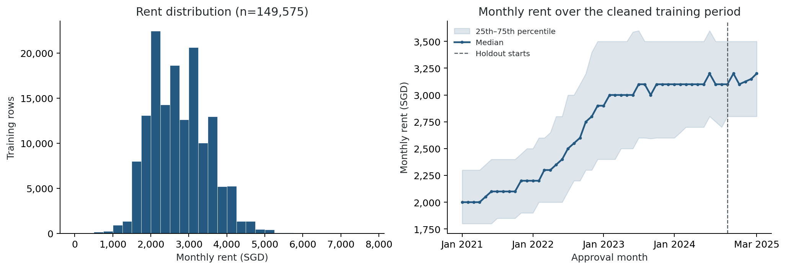
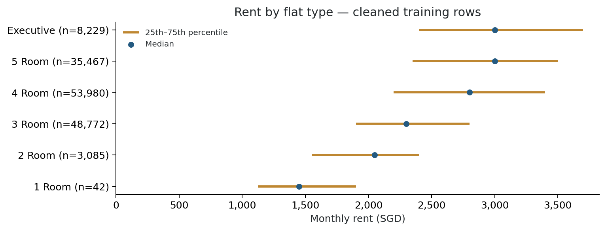
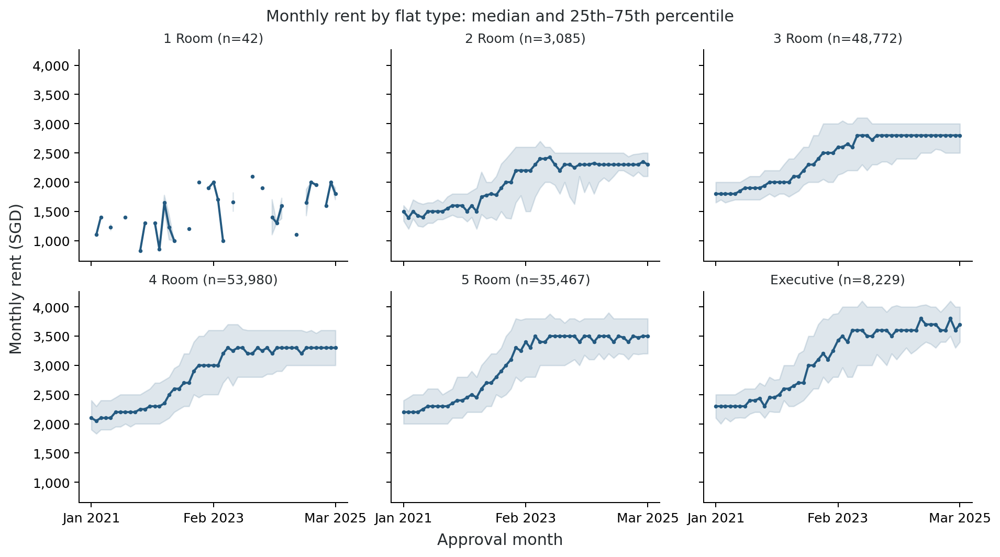
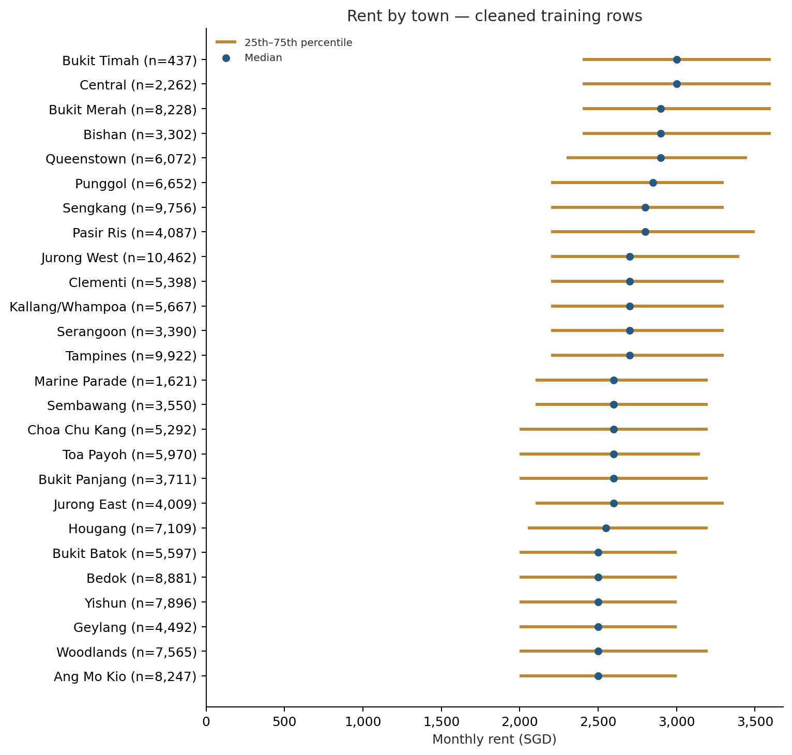
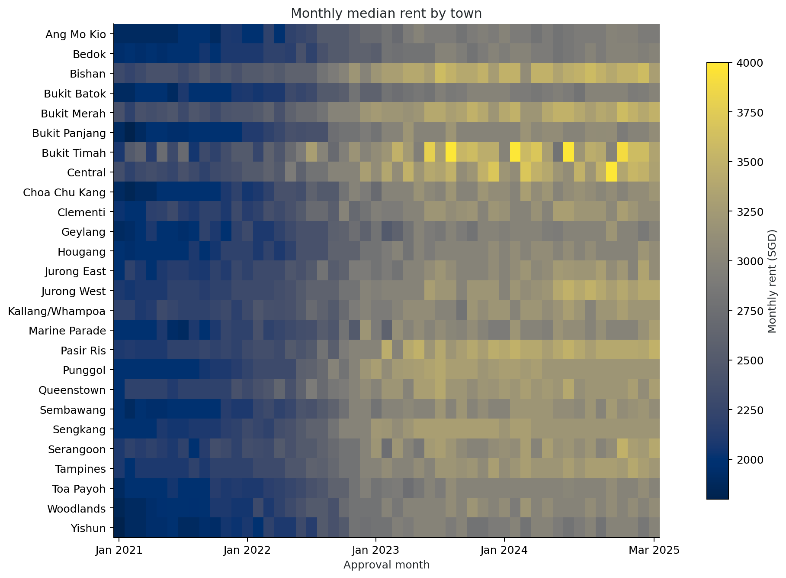
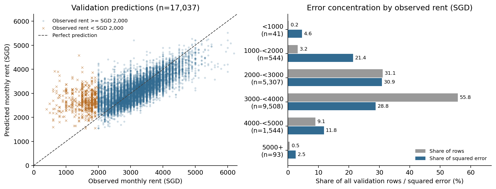
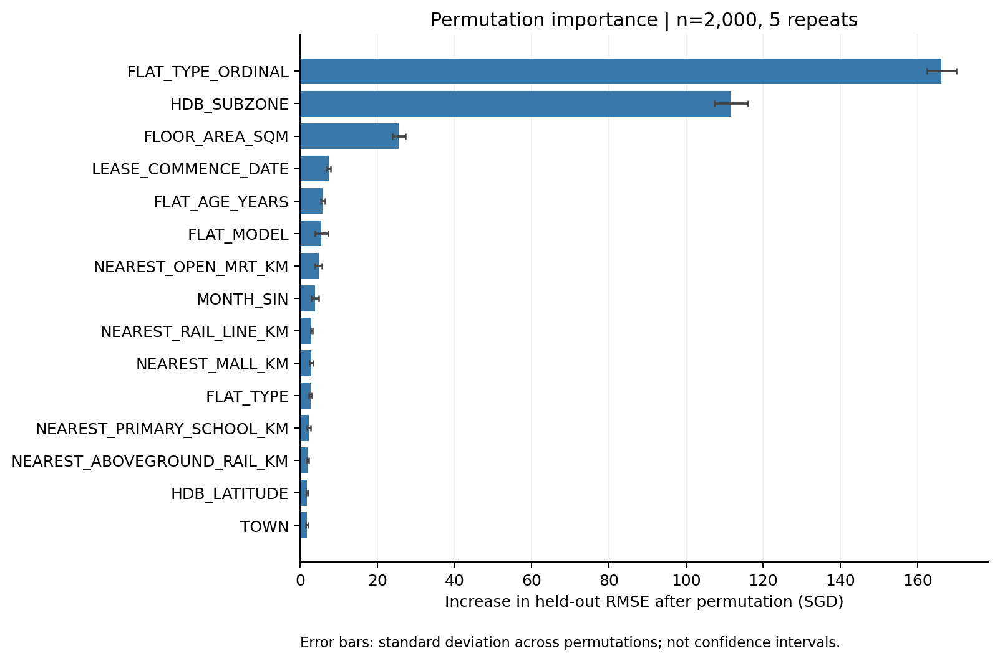
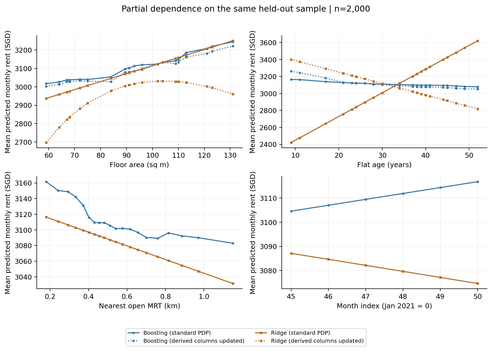

# Error analysis, interpretation and EDA

The analysis covers rent EDA, repeated-profile dispersion, residual breakdowns and case review, plus permutation importance and partial dependence for the selected model. This contribution uses the shared preprocessing and model configuration; reproduction requires two fixed holdout fits. The lossless WebP previews retain the original chart pixels and dimensions. Matching [PDF figures](figures/analysis/) embed those pixels losslessly for use with pdflatex.

## Recorded findings

Both models fit January 2021–September 2024 (132,538 rows) and validate October 2024–March 2025 (17,037 rows), using the same 39 G0+G1 inputs and index targets. Residual means **prediction minus truth**.

| Model | RMSE (SGD) | MAE (SGD) | MAPE (%) | Bias (SGD) |
| --- | ---: | ---: | ---: | ---: |
| Selected LightGBM | 445.78 | 323.91 | 12.25 | −24.51 |
| Matched Ridge | 467.13 | 347.45 | 12.94 | −57.54 |

**EDA:** cleaning removes 425 exact duplicates, leaving 149,575 labelled rows and preserving all 50,000 test rows. Training spans January 2021–March 2025; test spans March 2025–July 2026. Median rent rises from SGD 2,100 in 2021 to 3,100 in 2024. Time has Spearman rho 0.564 and Pearson r 0.535.











**Errors:** absolute errors above SGD 1,000 occur in 3.87% of validation rows but contribute 38.13% of squared error. The 20 largest errors are all overpredictions; nine have observed rent below SGD 1,000. Monthly RMSE does not worsen monotonically over the six holdout months.

**Hypothesis:** Some low amounts may represent room rent or one tenant's share of rent in a shared household, while area and flat type describe the whole flat. If these amounts are mixed with whole-flat rents, the missing distinction could contribute to overprediction and within-profile price differences. The supplied fields do not identify what each rent covers, so this explanation remains unverified. Confirmation would require original listings, tenancy agreements or an explicit room/whole-flat field; price alone cannot establish the arrangement.

Other unverified explanations include discounted or long-standing tenancy agreements, differences in unit condition or floor that the inputs omit, and errors or differences in the amount declared by the owner.

**Public-source check:** The March 2025, 112A Depot Road, 5-room record at SGD 650 has a matching entry in [HDB's rental table](https://data.gov.sg/datasets/d_c9f57187485a850908655db0e8cfe651/view). [HDB describes these amounts](https://api-production.data.gov.sg/v2/public/api/collections/166/metadata) as rents agreed with tenants and declared by owners; HDB does not verify their accuracy. The public table has no unit number or listing URL, so the match verifies a published amount without recovering the original advert or confirming the shared-household hypothesis. See the [record check](../results/analysis/reference/source_record_check.json). The original source of every competition row has not been established.



**Repeated profiles:** normalized block identity, flat type, exact area and approval month produce 18,014 repeated training groups covering 39,563 rows. Mean group sample SD is SGD 364.19. On the same 4,207 repeated holdout rows, leave-one-out group-mean RMSE is SGD 612.17 versus model RMSE 445.79. This descriptive calculation uses other holdout labels and does not establish an irreducible error floor.

**Interpretation:** on 2,000 fixed holdout rows with five permutations and seed 5228, ordinal flat type, subzone and floor area have the largest RMSE effects (+166.19, +111.65 and +25.61 SGD). Boosting's MRT response is nonlinear; Ridge's is linear. Area/age sensitivities update derived inputs alongside the primary feature.

The month permutation effect is only +0.057 SGD RMSE over the six holdout months. Permuting `MONTH_INDEX` changes both the model input and the training-fitted rent-index multiplier. The small effect reflects the shallow fitted index slope over this window and does not imply that historical rent trends are weak; see the [archived interpretation](analysis_review.md#interpretation).





Compact evidence: [metrics](../results/analysis/reference/metrics.csv), [permutation importance](../results/analysis/reference/permutation_importance.csv), [profile dispersion](../results/analysis/reference/repeated_profile_summary.csv), and [archived verification](../results/analysis/reference/verification.json). The [archived manual review](analysis_review.md) preserves the case tables and interpretation explanations.

Low observed rents do not confirm recording errors. Missing unit/tenancy attributes, correlated inputs and unrealistic PDP combinations limit interpretation. Permutation repeat SD is variation across shuffles, not a confidence interval. This holdout guided tuning and selection, and covers only six months of the longer forecasting horizon.

## Reproduce

Use Python 3.10 and the [analysis dependencies](../requirements-analysis.txt), following the [project setup](../README.md#setup). Place all eight competition CSVs as described in [data/README.md](../data/README.md). From the repository root with the environment activated, build the shared features if needed, then run the analysis:

```bash
python -c "from src.data_preprocessing import run_pipeline; run_pipeline(audit_dir='data/processed/analysis_audit')"
python -m scripts.run_analysis --output results/analysis/reproduction
python -m unittest discover -s checks -v
```

Use fresh analysis output names for reruns. These commands work in PowerShell, macOS and Linux after activation. Checks use synthetic fixtures and can run without Kaggle data.

The preprocessing command rebuilds the shared `data/processed/train_features.parquet` and `test_features.parquet`; skip it when current processed features are already available. The shared raw-data loader handles padded CSV headers while preserving the original files. The command writes its audit under ignored `data/processed/analysis_audit/` to preserve the committed audit. The analysis uses the committed `configs/lightgbm_tuned.json` selected by [Member C](boosting_model_choice.md#5-final-model-choice), with source run `20261025-210800_lightgbm_tuned_G0+G1_time_index`; it does not retune the model.

Each run produces `report.md`, `sections.tex`, EDA/residual/interpretation figures and source tables beneath its output directory. `manifest.json` records configuration, inputs, environment and reference agreement. Generated runs, predictions and model bundles stay ignored. The repository keeps the compact reference snapshot, archived prose, lossless WebP previews and PDF copies converted from those previews.

Convert the committed WebP previews to PDFs without rerunning the analysis:

```bash
python -m scripts.export_report_figures
```

To refresh the WebP previews and PDF copies from a reproduced run:

```bash
python -m scripts.export_report_figures --input results/analysis/reproduction
```

The runner checks source protocol and RMSE/MAE/MAPE/bias agreement within 0.05 in each metric's units before interpretation. Original teammate row predictions were unavailable, so archived agreement is aggregate-only. A rerun regenerates calculations and figures; its cases need a separate manual review.

For the team report, keep Data/EDA near 1.5 pages and Error Analysis/Interpretation near 1.25 pages. Compile the assembled report and check its eight-page limit; names, student IDs, workload allocation and final proofreading remain shared tasks.
