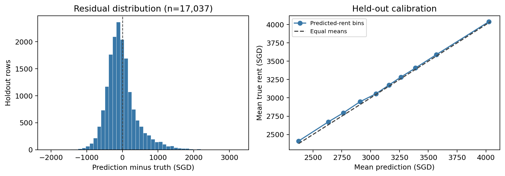
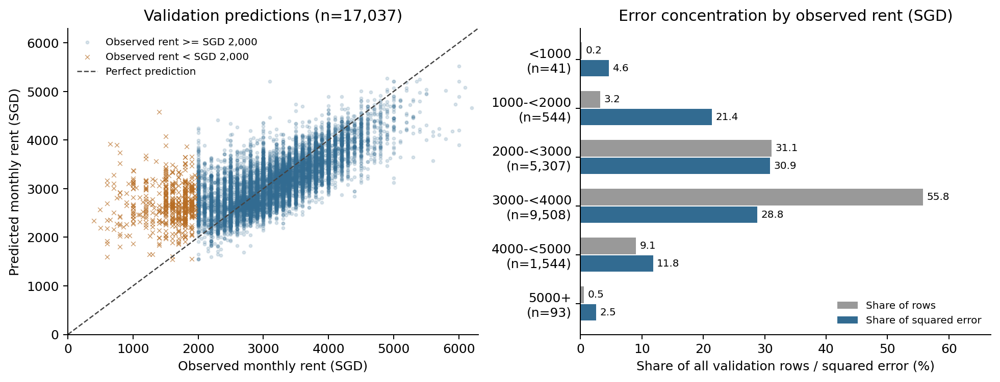
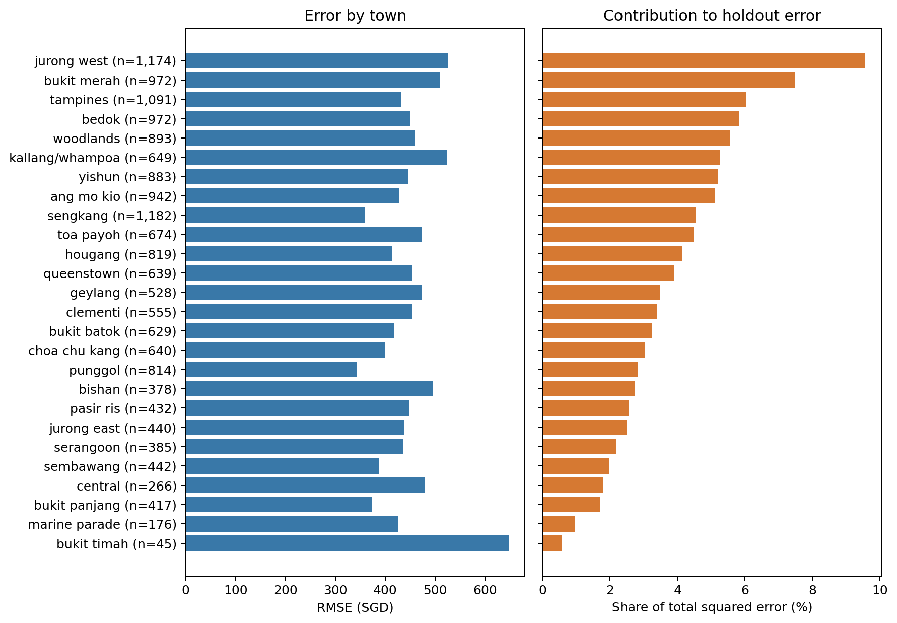
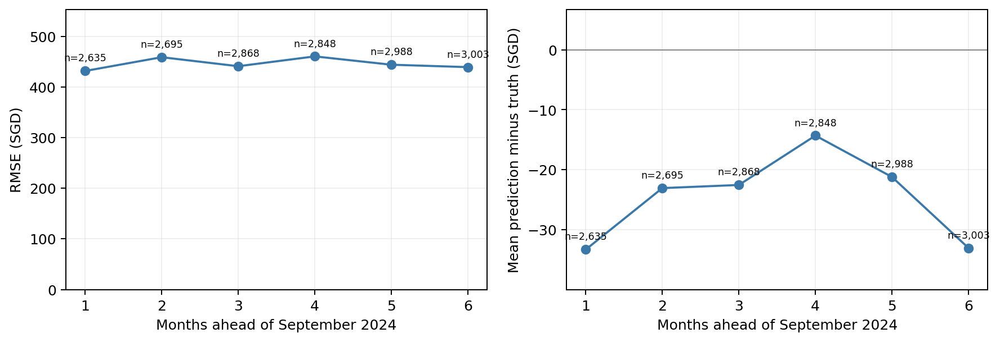
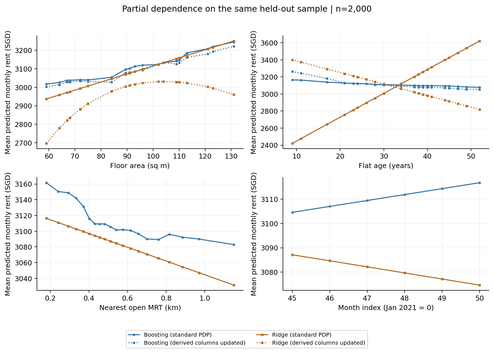

# Archived case and interpretation review

This manual review describes the **2 November 2026 local refit** of `lightgbm_tuned`, G0+G1, index target, seed 5228, with a matched 39-input Ridge comparison. Both fit January 2021–September 2024 and validate October 2024–March 2025 (17,037 rows). The reference is `20261025-210800_lightgbm_tuned_G0+G1_time_index`; its original row predictions were unavailable, so agreement is established by aggregate metrics only.

The compact [reference metrics](../results/analysis/reference/metrics.csv) and [verification record](../results/analysis/reference/verification.json) retain archived evidence. Regenerate detailed case CSVs and figures using the [analysis commands](analysis.md#reproduce). These explanations belong to the archived run; a new run requires its own manual review. All amounts below are SGD and residual means prediction minus truth.

## Error patterns

The model has RMSE SGD **445.78**, MAE **323.91**, MAPE **12.25%** and bias **−24.51** across 17,037 rows. Residual means prediction minus truth. Although 60.20% of observations are underpredicted, positive errors account for 59.91% of total squared error: the overprediction tail is less frequent but more severe. The 20 largest absolute errors are all overpredictions and together contribute 3.91% of squared error; both signs are therefore reviewed separately below.

The clearest concentration is in retrospectively defined low true rents. The 585 observations below SGD 2,000 represent **3.43% of rows but 25.99% of squared error**, with RMSE SGD 1,226.50 and bias +1,112.23. Within them, the 41 rents below SGD 1,000 contribute 4.59% of total squared error. This diagnoses a low-target tail; neither a price threshold nor a large residual confirms a recording error, room rental or housing programme. True-rent bands cannot be used at inference time.

Large flats have somewhat higher per-row error but do not carry most total error. The 5-room and executive categories comprise 27.80% of rows and 31.32% of squared error; 3-room and 4-room flats contribute **66.12%**. Executive RMSE is SGD 524.32 on 851 observations. Jurong West is the largest town contributor (9.57%, n=1,174), followed by Bukit Merah (7.47%, n=972). The town labelled `central` contributes only 1.81% (n=266). Defining proximity explicitly as less than 5 km from Raffles Place gives 2,066 rows (12.13%) and 15.75% of squared error, with RMSE SGD 507.97. These results do not support a claim that central locations account for most error.

Monthly RMSE is 431.49, 458.65, 440.85, 460.25, 443.81 and 439.05 SGD at horizons 1–6. There is no monotonic deterioration across this window. Bias remains slightly negative in every month (−33.28 to −14.30 SGD). Longer-horizon extrapolation remains a limitation rather than the demonstrated dominant failure here. Predicted-rent decile means remain close to the calibration diagonal (bin biases −39.13 to −9.49 SGD), but averaging hides substantial errors at both true-rent tails.

With identical fit rows, input columns and index target handling, Ridge has RMSE SGD 467.13 and bias −57.54; boosting lowers RMSE by SGD 21.34 and has lower absolute error on 9,723/17,037 rows (57.07%). Boosting improves RMSE in every reported MRT-distance bin: 456.12 versus 481.43 SGD below 0.5 km (n=7,686), and 438.99 versus 456.91 SGD at 0.5–1 km (n=7,649). Town/type gains vary: Bukit Merah 3-room improves from 544.87 to 479.36 SGD (n=414), while Jurong West executive worsens from 580.39 to 600.65 SGD (n=99). The varying gains support a conditional model comparison; they do not by themselves prove which learned interaction or nonlinear distance response caused it. Consult the PDPs alongside these results.

## Review of the 20 largest absolute errors

All 20 source rents are between SGD 600 and 2,000, nine are below SGD 1,000, and the available area ranges from 65 to 146 m². There are eight 5-room, seven 4-room, three 3-room and two executive observations across 13 towns. Ten occur in November 2024. None has the available invalid-lease flag, nonpositive/missing area, or missing town/type flag. **No source-record error is confirmed.** One case belongs to a small observed town/type holdout segment; the others remain unexplained. A small holdout segment is a coverage flag, not a cause.

| ROW_ID | Town / flat type | True SGD | Prediction SGD | Residual SGD | Evidence / classification |
| --- | --- | ---: | ---: | ---: | --- |
| 147330 | Bukit Merah / 5-room | 650 | 3921.34 | +3271.34 | Low observed rent; unexplained. |
| 137245 | Bukit Timah / executive | 1400 | 4577.74 | +3177.74 | Town/type holdout n=3; fit n=32. Rare observed segment; cause unexplained. |
| 137603 | Ang Mo Kio / 5-room | 750 | 3896.88 | +3146.88 | Low observed rent; unexplained. |
| 138124 | Toa Payoh / 4-room | 800 | 3738.70 | +2938.70 | Low observed rent; unexplained. |
| 137920 | Kallang/Whampoa / 3-room | 800 | 3526.06 | +2726.06 | Same recorded profile also has rent 3550; origin of spread unverified. |
| 137697 | Tampines / 4-room | 700 | 3277.40 | +2577.40 | Low observed rent; unexplained. |
| 137580 | Bukit Merah / 5-room | 1500 | 4077.11 | +2577.11 | Unexplained. |
| 135829 | Yishun / 4-room | 600 | 3167.99 | +2567.99 | Low observed rent; unexplained. |
| 142449 | Jurong West / 5-room | 1200 | 3681.84 | +2481.84 | Unexplained. |
| 144886 | Jurong West / 5-room | 600 | 3079.28 | +2479.28 | Low observed rent; unexplained. |
| 149220 | Bishan / 4-room | 1200 | 3615.24 | +2415.24 | Unexplained. |
| 136288 | Jurong West / 5-room | 700 | 3101.74 | +2401.74 | Low observed rent; unexplained. |
| 137509 | Bedok / executive | 1500 | 3889.31 | +2389.31 | Town/type holdout n=38; unexplained. |
| 143686 | Jurong West / 4-room | 1000 | 3377.40 | +2377.40 | Unexplained; not in the strictly below-1000 band. |
| 133225 | Central / 3-room | 1008 | 3363.69 | +2355.69 | Unexplained. |
| 142555 | Bukit Merah / 3-room | 700 | 3008.64 | +2308.64 | Same recorded profile also has rent 2880; origin of spread unverified. |
| 135867 | Queenstown / 4-room | 2000 | 4239.80 | +2239.80 | Unexplained; not in the strictly below-2000 band. |
| 144281 | Jurong West / 5-room | 1350 | 3567.29 | +2217.29 | Unexplained. |
| 142088 | Clementi / 5-room | 2000 | 4215.92 | +2215.92 | Unexplained. |
| 133155 | Jurong West / 4-room | 1000 | 3212.19 | +2212.19 | Unexplained. |

Two paired examples directly illustrate recorded-profile dispersion. ROW_IDs **136125/137920** describe Kallang/Whampoa block 8 Boon Keng Road, November 2024, 3-room, 68 m², DBSS, lease year 2011, at rents **3550/800 SGD**. ROW_IDs **141383/142555** describe Bukit Merah block 130 Kim Tian Road, January 2025, 3-room, 65 m², improved, lease year 1976, at **2880/700 SGD**. All four values occur in the raw training file. Different units within a block, unrecorded tenancy details and possible misrecording remain alternative hypotheses; these records alone do not determine the explanation.

## Review of underpredictions

The ten largest underpredictions contribute 0.95% of total squared error. Their true rents range from SGD 4,400 to 6,000. All have valid available lease flags and positive recorded area. No data error is established.

| ROW_ID | Town / flat type | True SGD | Prediction SGD | Residual SGD | Evidence / classification |
| --- | --- | ---: | ---: | ---: | --- |
| 139592 | Kallang/Whampoa / executive | 6000 | 3895.92 | −2104.08 | Town/type holdout n=9, fit n=47; adjoined flat. Rare observed segment; cause unexplained. |
| 136856 | Kallang/Whampoa / 4-room | 5600 | 3578.89 | −2021.11 | Adjoined flat, 125 m², age 55; unexplained. |
| 139895 | Kallang/Whampoa / 3-room | 5000 | 3120.31 | −1879.69 | Terrace flat model has only 14 fit rows across all towns; rare observed model category. |
| 144939 | Bukit Merah / 3-room | 6000 | 4206.98 | −1793.02 | Unexplained. |
| 146848 | Bukit Merah / 4-room | 5000 | 3222.46 | −1777.54 | Unexplained. |
| 145090 | Bukit Merah / 5-room | 5800 | 4028.69 | −1771.31 | Unexplained. |
| 148111 | Bukit Merah / 3-room | 5900 | 4185.39 | −1714.61 | Unexplained. |
| 137892 | Yishun / executive | 5300 | 3648.70 | −1651.30 | Town/type holdout n=31; unexplained. |
| 142396 | Bukit Merah / 3-room | 5700 | 4105.57 | −1594.43 | Unexplained. |
| 138300 | Central / 3-room | 4400 | 2838.57 | −1561.43 | Same block/type/area/month/model/lease profile also has rent 2500 (ROW_ID 139068); spread unexplained. |

Unrecorded floor/storey, condition, renovation, facing, furnishing detail and tenancy context are plausible omitted information for the dataset. Their contribution is a hypothesis, not an established explanation assigned to any row above. Age, size or centrality alone does not explain these cases.

## Interpretation

Interpretation uses a fixed sample of 2,000 of the 17,037 holdout rows. Its baseline RMSE is SGD 435.99, compared with SGD 445.78 on the full holdout.

The largest individual permutation effects are ordinal flat type (+166.19 SGD RMSE, repeat SD 3.77), subzone (+111.65, SD 4.38), and floor area (+25.61, SD 1.75). These describe deterioration after independently shuffling one input, with five permutations on the same sample. SD describes permutation variation, not a confidence interval. Correlated and deterministically related inputs can share or mask importance, and shuffling can create implausible feature combinations.

Time has the strongest absolute numeric Spearman association with rent across all 149,575 cleaned rows (rho 0.5640), while its individual permutation effect over the six holdout months is only +0.057 SGD (SD 0.055). This is consistent with the different populations, time ranges and index-target model. All holdout month indices (45–50) exceed the fitted maximum (44), and the boosting model's normalized mean prediction is identical at both endpoints. Its small SGD month response comes from the retained training-fitted index: the fitted tail slope is SGD 2.4476 per month. This does not imply that historical time trends are unimportant. Subzone is categorical and has no numeric Spearman entry; assigning arbitrary category codes would not provide a valid equivalent ranking.

The following standard PDP changes are differences between averaged full-SGD predictions at the grid endpoints, holding every other column fixed. They describe the fitted functions, not observed premiums or causal effects.

| Input range | Boosting change (SGD) | Ridge change (SGD) |
| --- | ---: | ---: |
| Floor area: 59 to 131 sq m | +226.75 | +314.49 |
| Flat age: 9 to 52 years | -86.04 | +1197.01 |
| Nearest open MRT: 0.1796 to 1.1499 km | -78.72 | -84.93 |
| Month index: 45 to 50 | +12.16 | -12.43 |

The age comparison demonstrates the danger of changing an engineered input independently. Updating lease commencement together with age changes the age response to -209.57 SGD for boosting and -581.23 SGD for Ridge; Ridge's direction reverses. Updating log-area and area-per-room alongside area gives endpoint changes of +217.15 and +263.13 SGD, respectively. Ridge's coherent area curve peaks at 104 sq m and then falls toward 131 sq m; this is model behavior under a hypothetical combination, not evidence that larger real flats rent for less.

The boosting MRT curve is nonlinear: predicted rent falls SGD 45.75 from 0.1796 to 0.4022 km, then SGD 32.97 from 0.4022 to 1.1499 km, with small local reversals. Ridge's standard MRT curve is linear in distance. This demonstrates a response shape the fitted boosting model can represent; it does not by itself attribute the matched holdout RMSE improvement (467.13 to 445.78 SGD) to that one feature or to town/type interactions.

Interpretation remains limited by repeated model selection on this holdout, correlated inputs, implausible synthetic combinations, and the much longer test horizon. The coherent area/age sensitivities preserve exact derivative relationships but still hold other correlated flat and location attributes fixed. Month curves hold seasonal encodings and age fixed.
