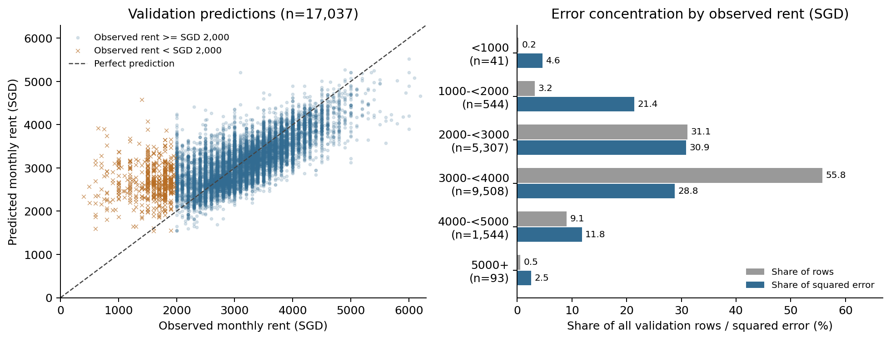

# Member D: findings and reproduction

The selected model predicts the centre of the rent distribution reasonably well, while a small tail of large errors contributes disproportionately to RMSE. Overprediction of unusually low observed rents is the clearest concentration. Several validation records have exactly the same 39 model inputs but materially different prices, illustrating information the model cannot distinguish. These observations do not identify which records are wrong or establish a universal irreducible error floor.

This is the completed local Member D contribution as of 2 November 2026. The [full report](../results/member_d/full/report.md), [LaTeX section fragments](../results/member_d/full/sections.tex), [case review](../results/member_d/full/residuals/case_review.md) and [interpretation notes](../results/member_d/full/interpretation/interpretation_notes.md) retain detailed evidence. The [manifest](../results/member_d/full/manifest.json) records inputs, configuration, source run, environment, commands and hashes.

## Holdout results and error concentration

Both models fit January 2021–September 2024 and validate October 2024–March 2025: 132,538 fit rows and 17,037 validation rows. Residual means **prediction minus truth**; positive means overprediction. With the same 39 inputs and index-target handling, boosting improves RMSE over Ridge by SGD 21.34, or 4.6%, and has lower absolute error on 9,723 rows (57.07%). This matched Ridge comparison differs from the older raw-target Ridge score of approximately SGD 575. [Metrics and comparison](../results/member_d/full/residuals/summary.json)

| Model | RMSE (SGD) | MAE (SGD) | MAPE (%) | Bias (SGD) |
| --- | ---: | ---: | ---: | ---: |
| Selected LightGBM | 445.78 | 323.91 | 12.25 | −24.51 |
| Matched Ridge | 467.13 | 347.45 | 12.94 | −57.54 |

The small overall bias hides asymmetric errors. Although 60.20% of validation observations are underpredicted, overpredictions contribute 59.91% of squared error. The 20 largest absolute errors are all overpredictions; nine have true rents below SGD 1,000. Together they contribute 3.91% of squared error. The ten largest underpredictions were also reviewed so that high-rent failures remain visible. [Case review](../results/member_d/full/residuals/case_review.md)

| Diagnostic cut | Rows | Share of validation rows | Share of squared error | Subset RMSE (SGD) |
| --- | ---: | ---: | ---: | ---: |
| Absolute error > SGD 1,000 | 659 | 3.87% | 38.13% | 1,399.70 |
| Observed rent < SGD 2,000 | 585 | 3.43% | 25.99% | 1,226.50 |
| Observed rent < SGD 1,000 | 41 | 0.24% | 4.59% | 1,946.99 |

These cuts overlap and cannot be added. True-rent bands are retrospective diagnostics, unavailable for routing future predictions. All observations remain in the reported RMSE of SGD 445.78. Removing the 20 largest errors would reduce RMSE to SGD 437.23, a selected-subset sensitivity rather than an improved model or valid replacement score. The [outlier summary](../results/member_d/full/residuals/outlier_summary.csv) and [rent-band metrics](../results/member_d/full/residuals/segment_metrics.csv) retain the source numbers, generated by [the residual analysis module](../src/member_d_residuals.py).



Executive flats have the highest flat-type RMSE, SGD 524.32, but only 851 observations and 6.91% of squared error. Five-room plus executive flats make up 27.80% of rows and 31.32% of squared error; the common 3-room and 4-room categories contribute 66.12%. Jurong West contributes the largest town share (9.57%), while the town named Central contributes 1.81%. Defining central proximity as less than 5 km from Raffles Place gives 12.13% of rows and 15.75% of squared error. These results distinguish per-row difficulty from total contribution and do not support a claim that central locations or large flats carry most error. [Segment metrics](../results/member_d/full/residuals/segment_metrics.csv)

Monthly RMSEs are **431.49, 458.65, 440.85, 460.25, 443.81 and 439.05 SGD** at horizons 1–6 after the September 2024 cutoff. Bias is slightly negative in every month. There is no monotonic deterioration in this window, even though ten of the top 20 errors occur in November. Trend extrapolation remains a longer-horizon risk, not the demonstrated dominant failure here. Calibration by prediction decile is close on average, but averages conceal errors in both target tails. [Month and horizon metrics](../results/member_d/full/residuals/segment_metrics.csv), [calibration](../results/member_d/full/residuals/calibration.csv)

## Cases worth discussing

Amounts below are SGD. Support counts refer to the actual fit and validation populations. The complete [top 20](../results/member_d/full/residuals/top20_errors.csv) and [largest underpredictions](../results/member_d/full/residuals/largest_underpredictions.csv) retain available attributes and unrounded predictions.

| ROW_ID | Available profile | Observed / predicted / residual | Evidence |
| --- | --- | --- | --- |
| 147330 | March 2025, Bukit Merah, 112A Depot Road; 5-room, 115 m², improved, age 19 | 650 / 3,921.34 / +3,271.34 | Largest absolute error. Town/type is common: 1,405 fit and 182 validation rows. No available structural metadata problem was flagged. |
| 137245 | November 2024, Bukit Timah, 3 Toh Yi Drive; executive, 146 m², maisonette, age 36 | 1,400 / 4,577.74 / +3,177.74 | Town/type support is 32 fit and 3 validation rows. Thin coverage is a plausible contributing factor, not a demonstrated cause of this price. |
| 139592 | December 2024, Kallang/Whampoa, 20 Saint George's Road; executive, 149 m², adjoined flat, age 40 | 6,000 / 3,895.92 / −2,104.08 | Largest underprediction. Town/type support is 47 fit and 9 validation rows; the premium's origin is unobserved. |
| 139895 | December 2024, Kallang/Whampoa, 46 Jalan Bahagia; 3-room, 92.1 m², terrace, age 52 | 5,000 / 3,120.31 / −1,879.69 | Town/type is reasonably represented, but the terrace model has only 14 fit and 5 validation rows. Rarity depends on the attribute examined. |

Three pairs match **exactly across all 39 model inputs** and receive the same prediction within each pair. Prices and residuals follow the listed ROW_ID order. [Verified case attributes](../results/member_d/full/residuals/case_review.md)

| ROW_IDs | Shared recorded profile | Observed rents | Shared prediction | Residuals |
| --- | --- | --- | ---: | --- |
| 137920 / 136125 | November 2024, 8 Boon Keng Road, Kallang/Whampoa; 3-room, 68 m², DBSS, lease year 2011 | 800 / 3,550 | 3,526.06 | +2,726.06 / −23.94 |
| 142555 / 141383 | January 2025, 130 Kim Tian Road, Bukit Merah; 3-room, 65 m², improved, lease year 1976 | 700 / 2,880 | 3,008.64 | +2,308.64 / +128.64 |
| 138300 / 139068 | December 2024, 29 Kelantan Road, Central; 3-room, 65 m², improved, lease year 1977 | 4,400 / 2,500 | 2,838.57 | −1,561.43 / +338.57 |

The first two pairs show a prediction close to one price and far above the other; the third demonstrates the higher-price tail. Matching block-level inputs does not identify the same physical unit. Storey, condition, facing, renovation, furnishing detail, tenancy context and a possible recording problem remain alternative hypotheses. **No individual recording error, room rental or housing programme is established.** Available invalid-lease, nonpositive/missing-area and missing-town/type checks flag none of the top 20 cases.

## EDA and repeated-profile dispersion

Training contains 149,575 cleaned labelled rows after removing 425 exact duplicates from 150,000 originals, retaining the first original ROW_ID. All 50,000 test rows and their order are preserved. Training spans January 2021–March 2025 and test March 2025–July 2026, with March 2025 overlapping. Cleaned median rent is SGD 2,650, with a range of SGD 300–7,600. Full-year median rent rises from SGD 2,100 in 2021 to SGD 3,100 in 2024; 2025 covers January–March only. The 374 training rents below SGD 1,000 are distinct from the progress narrative's suspicious observations and from IQR flags. [EDA sources and figures](../results/member_d/full/report.md)

Time has **Spearman rho 0.564 and Pearson r 0.535** over all cleaned labelled rows. Replace the earlier claim that no single feature is strongly associated with rent. Pearson measures linear association and Spearman rank association; neither establishes causation or exhausts nonlinear relationships. Shared trends and correlated attributes complicate rankings. Flat-type and town figures show median, interquartile range and counts; the one-room trajectory is sparse (42 rows across 30 months) and retains missing-month gaps.

Repeated profiles use normalized town/block/street identity (`ADDRESS_KEY`), canonical flat type, exact floor area and calendar approval month. Missing or malformed keys are excluded and counted; diagnostics do not deduplicate the cleaned input again. Spread summaries require at least two observations. Full training has 128,026 eligible groups, including 110,012 singletons; 18,014 repeated groups cover 39,563 rows (26.45%). Their unweighted mean sample SD is SGD 364.19, pooled sample SD SGD 467.99, self-inclusive group-mean RMSE SGD 345.39 and leave-one-out RMSE SGD 640.15. These aggregates have different denominators and are not interchangeable. Adding flat model and lease year leaves grouping and dispersion unchanged; missing-key exclusions are zero. Most repeated groups are pairs. [Definitions and source results](../results/member_d/full/repeated_profile_summary.csv), [group sizes](../results/member_d/full/eda/tables/repeated_profile_sizes_all_train_plan.csv)

Within the holdout, 1,900 repeated groups cover 4,207 rows (24.69%). Leave-one-out group-mean RMSE is SGD 612.17, versus model RMSE SGD 445.79 on exactly those rows. Leave-one-out excludes the focal rent from its group mean, but still uses other holdout labels. This descriptive calculation is not a deployable validation model, and no target-derived group values enter model features. Small groups, different units within a block and omitted attributes prevent these figures from establishing a universal RMSE floor or proven Bayes error. [Same-population comparison](../results/member_d/full/profile_model_comparison.csv)

## Model interpretation

Held-out permutation importance uses 2,000 fixed rows, five permutations per feature and seed 5228. Importance is **permuted RMSE minus baseline RMSE**, in SGD. The largest effects are ordinal flat type (+166.19; repeat SD 3.77), subzone (+111.65; SD 4.38) and floor area (+25.61; SD 1.75). Repeat SD measures permutation variation, not a confidence interval. Correlated features can share or mask importance, while independent shuffling can create implausible combinations. Categorical subzone has no directly comparable numeric Spearman coefficient. [Importance table](../results/member_d/full/interpretation/permutation_importance.csv)

MONTH_INDEX adds only about SGD 0.06 RMSE when permuted within the six holdout months. This short, later population and index-adjusted model differ from the full-history correlation calculation. The boosting model's normalized predictions are unchanged between the holdout month endpoints; its small SGD response comes from the training-fitted rent index. Historical time association remains relevant. [Interpretation notes](../results/member_d/full/interpretation/interpretation_notes.md)

Boosting's MRT curve is nonlinear, while Ridge's is linear over the inspected grid. This demonstrates representational flexibility without attributing the entire RMSE improvement to that feature. Ridge's standard age PDP rises SGD 1,197.01 from age 9 to 52 when lease year stays fixed; recomputing lease year consistently reverses the change to −581.23. Corresponding boosting changes are −86.04 and −209.57. Area sensitivities likewise update log-area and area-per-room. All four requested PDPs—area, age, MRT distance and month—describe fitted behaviour, not causal effects. Correlated inputs and implausible hypothetical combinations remain limitations; month curves hold seasonal encodings and age fixed. [PDP values and qualifications](../results/member_d/full/interpretation/interpretation_notes.md)

## Reproduce and verify

Use **Python 3.10** and the pinned repository [requirements](../requirements.txt), following the [project setup](../README.md). Place the competition CSVs as described in [data setup](../data/README.md). From the repository root in PowerShell, use fresh staging and output directory names:

```powershell
& '.venv/Scripts/python.exe' -m scripts.prepare_member_d_data --staging tmp/member_d_inputs_reproduction
& '.venv/Scripts/python.exe' -m scripts.run_member_d --member D --output results/member_d/full_reproduction
```

Preparation trims padded headers/text in ignored staging copies where needed, preserves all input rows/order and identifiers, and invokes the unchanged shared preprocessing. Original CSVs remain untouched. Analysis performs two fixed holdout fits; it adds no tuning, CV, external datasets or Kaggle submission. Full predictions, model bundles, fit IDs and detailed address-level group tables remain local and ignored; compact source tables and report assets remain reviewable.

[Member C's selected configuration](boosting_model_choice.md#5-final-model-choice) is `lightgbm_tuned`, G0+G1, index targets, retaining unusual observations. Source run: `20261025-210800_lightgbm_tuned_G0+G1_time_index`. The existing `configs/lightgbm_tuned.json` is required; its parameters were tuned on raw targets and are reused with the selected index wrapper. Matched Ridge uses `make_ridge` (alpha 1), all 39 inputs and the same target mode; Member B's reduced-input `ridge` is a separate baseline. Preprocessing and the rent index fit only the shared fit rows, and predictions, permutations and PDPs restore SGD through the retained fitted bundle.

Before interpretation, the refit's protocol and RMSE/MAE/MAPE/bias must match the source record within an absolute tolerance of 0.05 in each metric's units. Original teammate predictions were unavailable, so archived agreement is aggregate-only; matching metrics do not establish identical row-level predictions. Reloaded local models reproduce their own saved predictions by ROW_ID. The [verification record](../results/member_d/full/verification.json) retains numerical and visual checks.

Run the baseline and Member D checks with default test discovery:

```powershell
& '.venv/Scripts/python.exe' -m unittest discover -s checks -v
```

Checks cover ID-preserving joins and target alignment, dates/bins, residual sign, metric and squared-error aggregation, missing/small groups, independent dispersion/leave-one-out formulas, reproducible sampling, training-only indices and SGD restoration. Independent real-data audits additionally checked raw targets, all four profile populations/definitions, segment metrics, error rankings, importance statistics and selected PDP values. Synthetic fixtures are separate from report evidence. The reviewed case explanations and interpretation notes belong to this saved run; a rerun regenerates calculations and figures but does not establish a new manual case review.

## Limits and report handoff

Unrecorded unit and tenancy attributes are plausible limitations, not established causes assigned to specific rows. Same-month CPI, COE and stock features may be unavailable when forecasting; the selected G0+G1 model excludes them. Static rail/POI snapshots do not establish historical opening dates. The holdout guided tuning and selection, so it is not an untouched test of future generalisation; its six months also do not establish performance through the full test horizon to July 2026.

Keep Data/EDA near 1.5 pages and Error Analysis/Interpretation near 1.25 pages, moving detailed cases, segments and extra figures to the appendix. The supplied LaTeX prose aids integration; no TeX compiler is installed locally, so the assembled eight-page report limit remains to be checked. Names/student IDs, team name, workload table and final proofread remain shared responsibilities. The reviewed plan does not specify the final deadline.
