# Member D: data, error analysis and interpretation

## Data and EDA

The target is monthly rent in SGD for Singapore HDB flats. The cleaned labelled population contains 149,575 rows from 2021-01-01 to 2025-03-01. The saved audit records 150,000 original rows and 425 exact training duplicates removed, keeping the first original ROW_ID. All 50,000 test rows, including duplicate profiles, are retained in their original order, covering 2025-03-01 to 2026-07-01. Overlapping approval months are 2025-03; this is predominantly future-month prediction rather than a perfectly disjoint calendar split.

Available attributes describe approval month, town, block/street, flat type and model, area and lease commencement. Furnishing and fee are constant and removed upstream. Normalized town/block/street identify the block for enrichment; the chosen G0+G1 input set has 39 core and location columns. Missing unit storey and condition remain limitations. Unusual rents are retained: 374 cleaned rows are below SGD 1,000, a descriptive threshold distinct from the team's suspicious-row flags.

Across all cleaned labelled rows, median rent is SGD 2650, mean SGD 2718, and observed range SGD 300–7600. Annual median rent rose from SGD 2100 in 2021 to SGD 3100 in 2024. Flat-type medians range from SGD 1450 to SGD 3000; town medians range from SGD 2500 to SGD 3000. These descriptive comparisons mix approval dates, flat types and locations and do not isolate a town or size effect. Time has a strong monotonic association with rent (Spearman rho 0.564; Pearson r 0.535) on 149,575 complete rows. Pearson measures linear association; Spearman measures rank association. Neither establishes causation or exhausts nonlinear relationships, and shared trends and correlated attributes complicate rankings. Held-out permutation importance provides a complementary model-based nonlinear view.

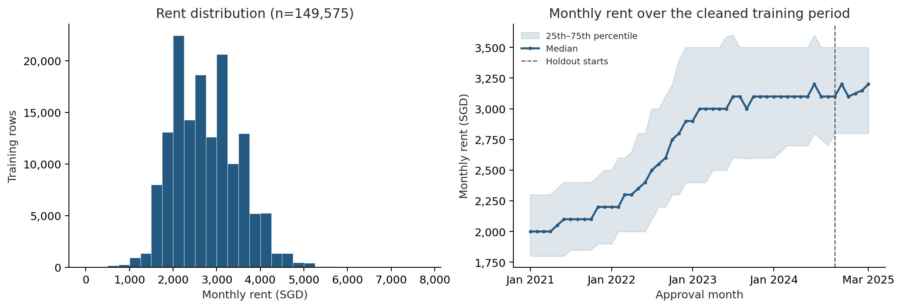

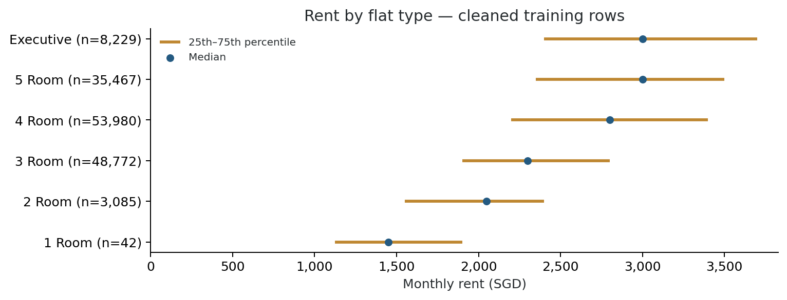

## Error analysis and interpretation

Using the shared October 2024–March 2025 holdout, the reproduced selected LightGBM configuration has RMSE SGD 445.78, MAE SGD 323.91, MAPE 12.25% and bias SGD -24.51 on 17,037 rows. Residual means prediction minus truth; positive values indicate overprediction. This holdout also guided tuning and model selection, so it is not an independent post-selection test.

RMSE does not increase monotonically from horizon 1 to 6 (SGD 431.49 to SGD 439.05); this window does not establish worsening trend drift. The highest-error flat type is executive (n=851, RMSE SGD 524.32), contributing 6.9% of squared error. The largest town contribution is jurong west: 9.6% from 1,174 rows. Absolute errors above SGD 1,000 occur in 659 rows (3.87%) and contribute 38.13% of squared error. Retrospectively, true rents below SGD 2,000 form 3.43% of rows but 25.99% of squared error; this low-rent tail is an observed limitation, not evidence that the records are wrong. Complete segment counts, biases and contributions are retained in the appendix assets.

For profiles defined by normalized block identity, flat type, exact area and approval month, 18,014 repeated groups cover 39,563 rows (26.5% of cleaned training). Their unweighted mean group sample SD is SGD 364.19; pooled sample SD is SGD 467.99. On groups formed only inside the holdout, leave-one-out group-mean RMSE is SGD 612.17, versus model RMSE SGD 445.79 on the same 4,207 rows. Small groups inflate leave-one-out error. This selected-subset dispersion is neither a proven universal RMSE floor nor a deployable validation model. Adding flat model and lease year leaves group counts, coverage and dispersion unchanged. The appendix distinguishes all SD/RMSE denominators and self-inclusion.

With identical fit rows, 39 inputs and index handling, Ridge RMSE is SGD 467.13; boosting improves this by 4.6%. Paired distance and town/type tables describe where predictions differ. Boosting has a nonlinear MRT response while Ridge's response is linear over the inspected grid. The largest permutation effects are FLAT_TYPE_ORDINAL (+166.2 SGD RMSE, repeat SD 3.8), HDB_SUBZONE (+111.6 SGD RMSE, repeat SD 4.4), FLOOR_AREA_SQM (+25.6 SGD RMSE, repeat SD 1.7), measured on 2,000 fixed held-out rows over 5 repeats. SD describes repeat variability, not a confidence interval. Despite time's full-training Spearman association, its permutation effect in this six-month index-adjusted sample is only 0.06 SGD RMSE. Correlated inputs can share or mask importance; rankings are not causal. The four PDPs describe model behavior. Area/age sensitivity curves update their engineered derivatives; month curves include index restoration but hold seasonal and age columns fixed. Implausible combinations remain a limitation.

The 20 largest absolute errors include 20 overpredictions and 0 underpredictions. Of these, 9 have true rent below SGD 1,000 and 1 belong to a town/type with fewer than 30 holdout rows. These flags do not establish a cause. Separate signed extremes cover both directions. Case review retains observed metadata flags and unexplained cases; no price alone is called a confirmed error.

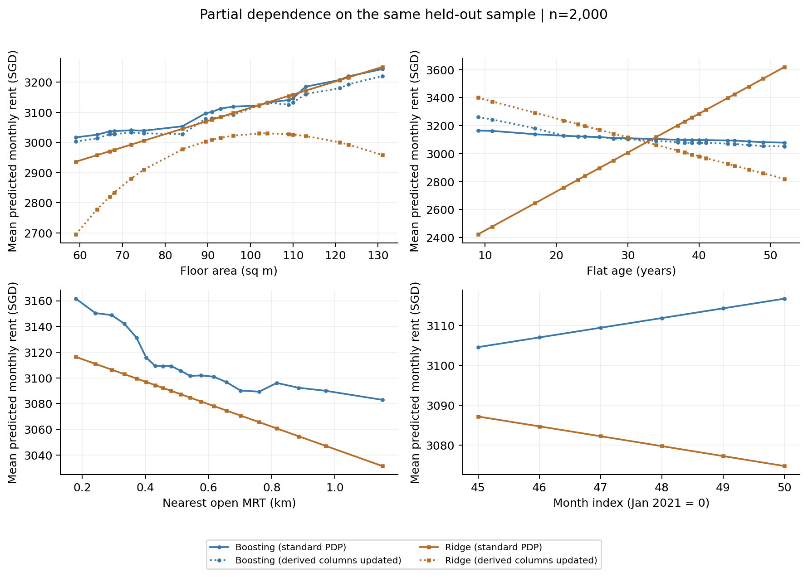

## Limitations contribution

Unrecorded storey, renovation, condition, facing, furnishing detail and tenancy context plausibly limit accuracy, but cannot be assigned as causes for specific records. Same-month CPI, COE and stock inputs may be unavailable at forecast time; the selected G0+G1 model excludes them. Static rail/POI snapshots do not establish historical opening dates. Repeated-profile groups may mix different units, omit recorded attributes and have very small sizes. Correlated inputs and implausible synthetic combinations limit interpretation. The six-month holdout does not establish behavior across the full test horizon to July 2026, and using it repeatedly for model selection introduces selection optimism.

## Appendix and reproducibility

Source run: `20261025-210800_lightgbm_tuned_G0+G1_time_index`. The refit uses the stored tuned configuration, seed 5228, G0+G1, index targets and exactly the shared fit mask; Ridge uses `make_ridge`, not Member B's narrower feature selector. Reference verification: aggregate metrics only. See manifest.json for exact tolerances, timing, versions, input/code/config hashes and the generation command. Metric agreement alone does not prove original row-level prediction agreement.

### Repeated-profile denominators

| population_profile | input_rows | excluded_missing_key_rows | repeated_groups | repeated_rows | coverage_fraction_all_rows | unweighted_mean_group_sample_sd_sgd | row_weighted_rms_group_sample_sd_sgd | pooled_within_group_sample_sd_sgd | self_inclusive_group_mean_rmse_sgd | leave_one_out_group_mean_rmse_sgd |
| --- | --- | --- | --- | --- | --- | --- | --- | --- | --- | --- |
| all_train_plan | 149575 | 0 | 18014 | 39563 | 0.26 | 364.19 | 467.89 | 467.99 | 345.39 | 640.15 |
| all_train_strict | 149575 | 0 | 18014 | 39563 | 0.26 | 364.19 | 467.89 | 467.99 | 345.39 | 640.15 |
| holdout_plan | 17037 | 0 | 1900 | 4207 | 0.25 | 348.45 | 448.67 | 448.78 | 332.33 | 612.17 |
| holdout_strict | 17037 | 0 | 1900 | 4207 | 0.25 | 348.45 | 448.67 | 448.78 | 332.33 | 612.17 |

Within repeated groups let SSE_g=sum((rent-group_mean)^2). Unweighted mean SD averages sample SD_g; row-weighted RMS SD is sqrt(sum(n_g*SD_g^2)/sum(n_g)); pooled SD is sqrt(sum(SSE_g)/sum(n_g-1)); self-inclusive RMSE is sqrt(sum(SSE_g)/sum(n_g)); leave-one-out RMSE is sqrt(sum(SSE_g*(n_g/(n_g-1))^2)/sum(n_g)). None are interchangeable. Missing/empty/malformed profile keys are excluded and counted; area is not rounded. Group and size-distribution tables cover full training and holdout under both definitions. No target-derived values enter the prediction features.

The all-training plan definition has 128,026 eligible groups, including 110,012 singletons; the holdout has 14,730 groups including 12,830 singletons. Missing-key exclusions are 0 and 0, respectively. Median repeated-group sizes are 2.0 and 2.0; maximum sizes are 7 and 7. Detailed counts by group size are in eda/tables/repeated_profile_sizes_*.csv. These small groups explain why leave-one-out dispersion should not be read as a universal lower bound. The one-room EDA trajectory is sparse and its gaps are retained; sample counts are shown in the figures and tables.

### Additional figures and source tables

| population | n | row_share_pct | squared_error_share_pct | rmse_sgd | bias_sgd |
| --- | --- | --- | --- | --- | --- |
| All validation rows | 17037 | 100.00 | 100.00 | 445.78 | -24.51 |
| Absolute error > SGD 1000 | 659 | 3.87 | 38.13 | 1399.70 | 993.49 |
| True rent < SGD 2000 | 585 | 3.43 | 25.99 | 1226.50 | 1112.23 |
| True rent >= SGD 2000 (retrospective) | 16452 | 96.57 | 74.01 | 390.26 | -64.93 |
| Top 20 absolute errors removed (retrospective) | 17017 | 99.88 | 96.09 | 437.23 | -27.54 |

These overlapping diagnostic populations must not be added together. Rent-based cuts and removal of the largest errors are retrospective sensitivities, not revised validation scores. All holdout rows remain in the official metrics.

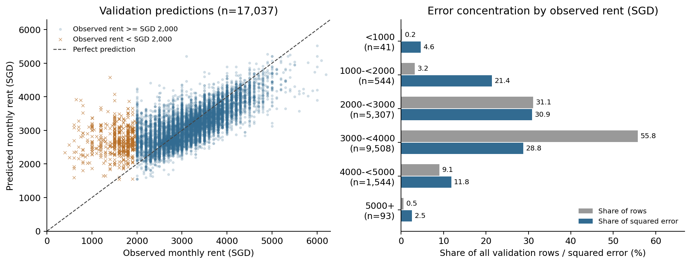
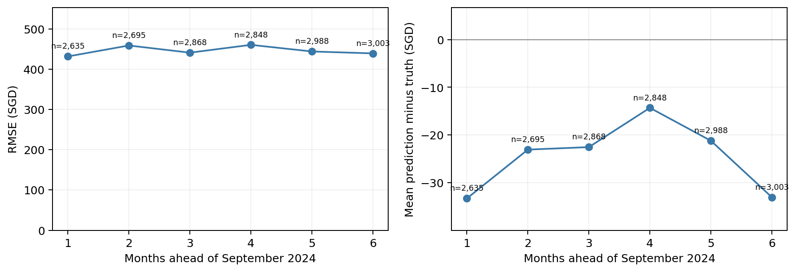
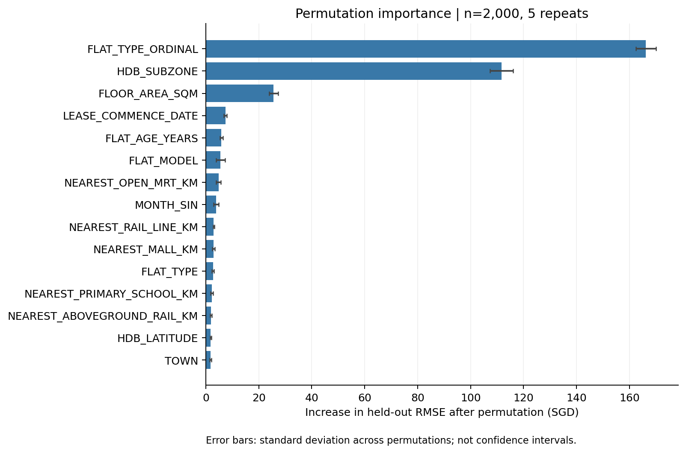
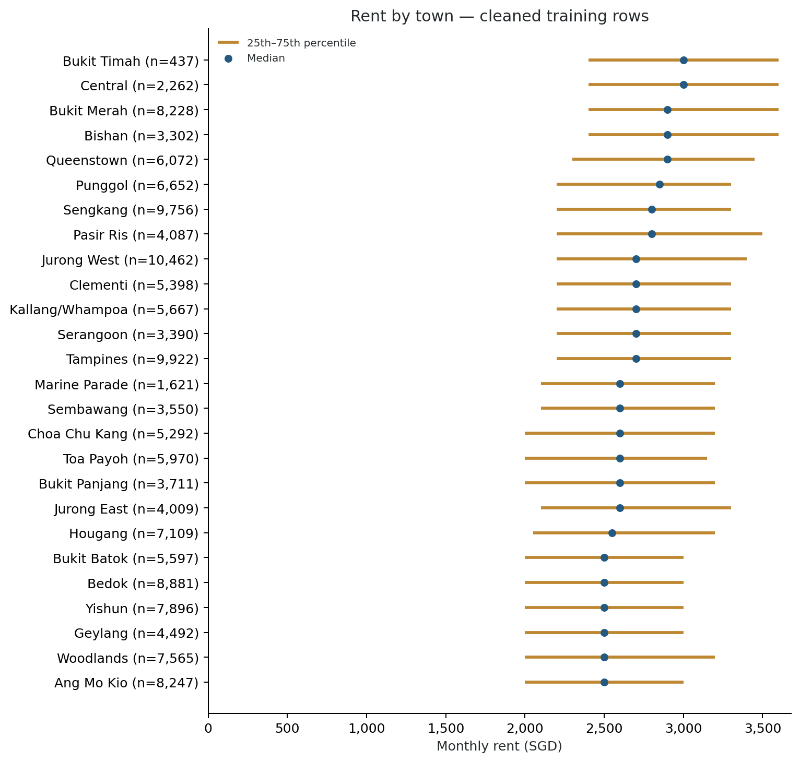
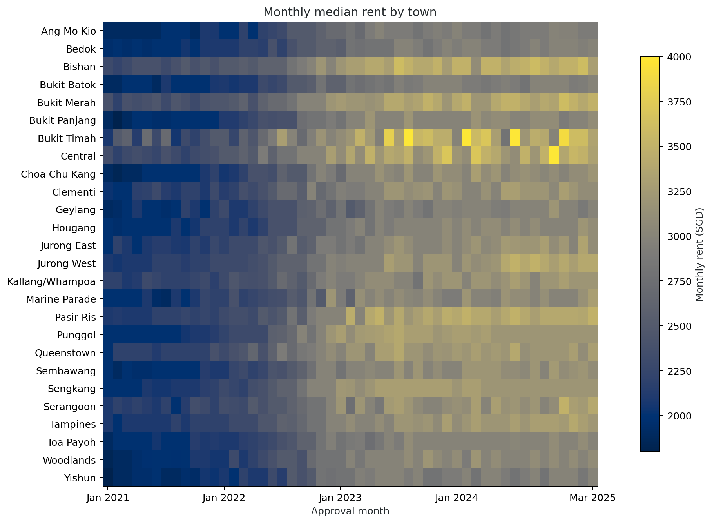
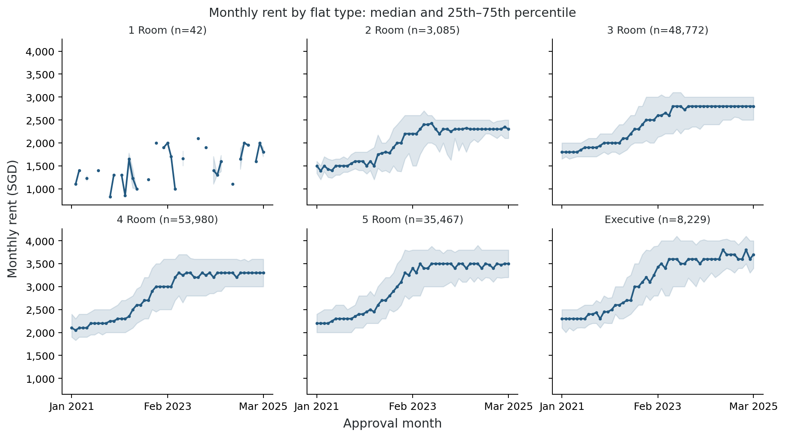
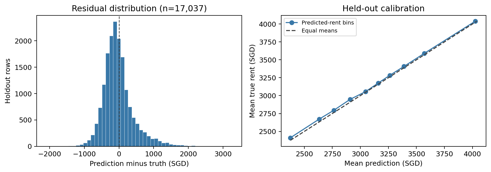
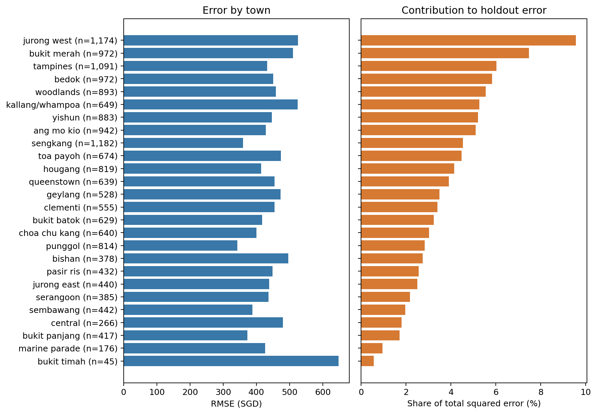

Detailed reviews are in [error cases](residuals/case_review.md) and [interpretation notes](interpretation/interpretation_notes.md). These retain supported evidence, the limits of plausible explanations and response-curve comparisons.

All segment metrics are in residuals/segment_metrics.csv; bins and missing handling are in residuals/summary.json. Squared-error shares reconcile within each segmentation, which must not be summed across overlapping segmentations. True-rent bands are retrospective diagnostics, never inference-time inputs. Case attributes and evidence labels are in residuals/top20_errors.csv and both signed-extreme tables. Correlations versus model importance are aligned in correlation_vs_importance.csv; every repeat, sampled ROW_ID and PDP ordinate is retained under interpretation/. PDF figures are exported beside PNGs for the course LaTeX report. Main-report allocations remain approximately 1.5 pages for Data/EDA and 1.25 pages for Error Analysis/Interpretation; check the final integrated report against the eight-page limit. Names, student IDs, team name and the full workload table remain team-level completion checks; the final deadline is unspecified.
